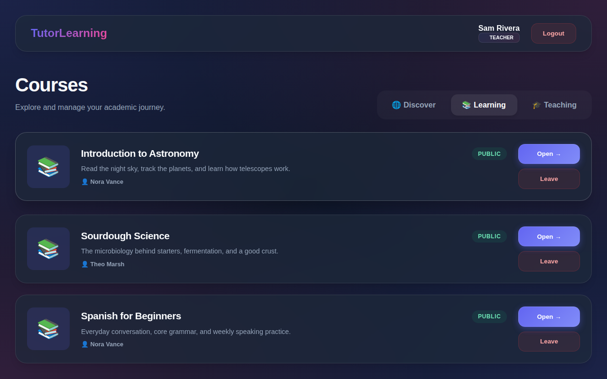

# TutorLearning

A web app where teachers run online courses and students enroll, read course posts, and submit assignments.

> **Unfinished, not safe to expose.** The API has no access control. Run it locally. See [Status and limits](#status-and-limits).



*Dashboard from a local run with fictional data.*

## Highlights

- **One account, both roles.** A teacher can run courses and also enroll in other teachers' courses.
- **A single feed per course.** Posts, assignments with due dates, and files appear together, with the student list one tab away.
- **Welcome emails that survive a failed send.** Database triggers queue registration and enrollment emails, and each one is marked sent or failed with the error kept.
- **A documented schema.** The [database diagram](backend/uml/database_model.svg) covers every table.

## Run it locally

You need Docker, Python 3.11, and Node.js. These steps were tested with MySQL 8.4 and Node 22. MariaDB 11.8 also worked.

**1. Start a database.** Give it about 20 seconds to come up.

```bash
docker run -d --name tutor-db -e MYSQL_ROOT_PASSWORD=change-me \
  -e MYSQL_DATABASE=tutorlearning -p 127.0.0.1:3306:3306 mysql:8.4
```

**2. Start the backend.** It creates the tables and triggers on startup.

```bash
cd backend
python3.11 -m venv .venv && source .venv/bin/activate
pip install -r requirements.txt
export DB_HOST=127.0.0.1 DB_USER=root DB_PASSWORD=change-me DB_NAME=tutorlearning
uvicorn main:app --port 8000
```

`DB_HOST` is required: without it, the backend stops at startup with an error.

**3. Start the frontend.** It calls `http://127.0.0.1:8000` by default.

```bash
cd frontend
npm ci
npm run dev
```

Open <http://localhost:3000>.

### Optional sample data

Run this in a second terminal, with the virtual environment active and the same `export` line set.

```bash
cd backend
python seed_data.py
```

> **This drops every table** in the database that the `DB_*` variables select. Run it only against your local database.

It then adds 20 invented users at `example.com` and 25 courses, and prints test accounts with their password. The password is random on each run, unless you set `SEED_USER_PASSWORD`. Seeding queues no email.

## Usage

In the browser:

1. Sign up, and tick **Register as Teacher** if you want to run courses.
2. As a teacher, open the **Teaching** tab and choose **Create New Class**. New classes start as drafts, so edit the course to publish it.
3. As a student, open **Discover**, enroll in a public course, then open it to read the feed.

Or call the API directly. Interactive docs are at <http://127.0.0.1:8000/docs>.

```bash
curl -X POST http://127.0.0.1:8000/users/ -H 'Content-Type: application/json' \
  -d '{"first_name":"Sam","last_name":"Rivera","email":"sam@example.com","password":"change-me","is_teacher":false}'

curl -X POST http://127.0.0.1:8000/login/ -H 'Content-Type: application/json' \
  -d '{"email":"sam@example.com","password":"change-me"}'
```

## Configuration

The backend reads these environment variables, or a `backend/.env` file.

| Variables | Purpose | Without them |
|-----------|---------|--------------|
| `DB_HOST` | MySQL host | Startup fails, unless `INSTANCE_UNIX_SOCKET` is set |
| `DB_PORT`, `DB_USER`, `DB_PASSWORD`, `DB_NAME` | MySQL connection | Defaults in `backend/database.py`, with an empty password |
| `INSTANCE_UNIX_SOCKET` | Cloud SQL socket, used on Cloud Run instead of TCP | TCP connection through `DB_HOST` |
| `GCS_BUCKET_NAME` | Bucket for uploads | Uploads return a 500 error |
| `GCP_PROJECT_ID`, `GCP_PRIVATE_KEY`, `GCP_CLIENT_EMAIL` | Service account for the bucket | Application Default Credentials |
| `GMAIL_SENDER_EMAIL`, `GMAIL_APP_PASSWORD` | Sends queued email through Gmail SMTP | Emails are marked failed, and nothing is sent |
| `SEED_USER_PASSWORD` | Password for seeded accounts | Random password for each seed run |

The frontend reads one variable at build time. Set `VITE_API_URL`, with no trailing slash, when you build for a deployed backend: `VITE_API_URL=https://api.example.com npm run build`. Without it, the build calls `http://127.0.0.1:8000`.

## Tests

```bash
cd backend
pip install -r tests/requirements.txt
pytest tests
```

The tests never use your `DB_*` settings. Two seeding tests need real MySQL triggers and skip by default. To run them, set `TEST_DB_NAME`, `TEST_DB_PORT`, `TEST_DB_USER`, and `TEST_DB_PASSWORD` for a local, disposable database whose name contains `test`. They drop every table in it.

## Status and limits

This is unfinished work. The backend tests cover only recent fixes, and the frontend has no tests. `npm run build` passes, and `npm run lint` reports 4 errors.

**Security: do not expose this as it stands.**

- **No access control.** Login returns the user record but no session or token, and the API never checks who is calling. Without logging in, a request could list all users and turn an account into a teacher.
- **Open CORS.** The API allows requests from every origin.

**What needs Google Cloud.** These features were not tested with a real bucket, because the local runs had none:

- course file uploads, cover images, and assignment submissions, which all upload a file first
- cover images on seeded courses, which do not load unless the bucket holds them

**Known bugs and gaps.**

- Deleting a course removes its database rows but leaves its uploaded files in the bucket.
- The triggers use MySQL syntax, so other databases such as SQLite will not work.
- A `Dockerfile` for Cloud Run is included, but that deployment path was not tested.
